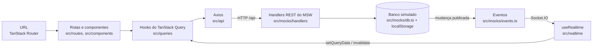

# Arquitetura · Kurio

Este documento explica como o projeto está organizado, por onde os dados passam e por que cada decisão foi tomada. Para instalar, rodar e testar, veja o [README](./README.md).

---

## 1. Visão geral

O app é uma SPA (React + Vite). O backend é simulado pelo **MSW** na camada de rede. A interface não sabe disso: faz requisições HTTP reais pelo Axios e recebe eventos reais pelo `socket.io-client`. Trocar o mock por uma API real é só desligar `VITE_ENABLE_MOCKS`.



A seta de volta é o ponto central: o tempo real **não altera a tela diretamente**. O evento chega pelo socket, atualiza o cache do TanStack Query, e a tela reage ao cache como em qualquer outra mudança.

---

## 2. Camadas

| Pasta | Responsabilidade | Não faz |
|---|---|---|
| `src/routes` | Páginas, validação dos parâmetros da URL, telas de 404 | Chamar a API diretamente |
| `src/components` | Interface por área (`catalog`, `nft`, `cart`, `home`, `layout`) e componentes base do shadcn (`ui`) | Guardar dados do servidor em `useState` |
| `src/queries` | Hooks do TanStack Query: chaves de cache, mutations, atualização otimista | Saber como a requisição é feita |
| `src/api` | Uma função por endpoint, cliente Axios único com interceptor | Lógica de tela |
| `src/realtime` | Conexão Socket.IO e aplicação dos eventos no cache | Mexer no DOM |
| `src/lib` | Funções puras: contas em ETH, validação dos filtros, armazenamento local | Depender de React |
| `src/types` | Contratos tipados entre API, cache e tela | |
| `src/mocks` | Backend simulado: banco, regras de negócio, handlers REST e Socket.IO, cenários de rede | Ser importado pela interface |

A interface depende de `queries`, que dependem de `api`. Nenhum componente importa nada de `src/mocks`. A única ligação é o `main.tsx`, que liga o MSW antes de montar o app.

---

## 3. Onde cada estado vive

| Estado | Onde fica | Por quê |
|---|---|---|
| Busca, filtros, aba, ordenação, página | **URL** (`validateSearch` do TanStack Router) | Sobrevive ao refresh, ao "voltar" e pode ser compartilhado por link |
| NFTs, detalhe, carrinho | **Cache do TanStack Query** | É dado do servidor: tem carregamento, erro, expiração e atualização |
| Id do carrinho do visitante, token de sessão | `localStorage` (`src/lib/storage.ts`) | Precisa durar entre visitas |
| Diálogo aberto, edição escolhida, campo do cupom | `useState` local | Só interessa ao componente |

A função `parseCatalogSearch` (`src/lib/catalog.ts`) é usada tanto pela rota quanto pelo handler do MSW. Um parâmetro inválido na URL vira o valor padrão nos dois lados, nunca um erro.

---

## 4. Dados do servidor (TanStack Query + Axios)

**Chaves de cache.** Ficam centralizadas em fábricas (`nftKeys`, `cartKeys`). Cada combinação de filtros tem a própria chave, então voltar a um filtro já visto é instantâneo.

**Respostas fora de ordem.** O `signal` do TanStack Query é repassado ao Axios. Quando o filtro muda, a requisição anterior é cancelada, e uma resposta antiga não pode sobrescrever a nova. O cenário `?scenario=jitter` existe para provocar isso.

**Política de cache** (`src/lib/query-client.ts`):

| Situação | Comportamento | Motivo |
|---|---|---|
| Dados recém-buscados | Frescos por 30 s | Evita refetch ao navegar entre páginas |
| Erro 4xx | Não repete | Repetir não resolve um NFT inexistente ou um cupom inválido |
| Falha de rede ou 5xx | Repete até 2 vezes | Pode ser falha passageira |
| Mutations | Nunca repetem sozinhas | Evita ação duplicada, como uma compra em dobro |

**Cliente HTTP** (`src/api/client.ts`). Um interceptor envia o token de sessão (`Authorization`) e o id do carrinho (`X-Cart-Id`). Erros da API seguem sempre `{ code, message }`, e `getErrorMessage` diferencia timeout, falta de conexão e erro do servidor.

**Atualização otimista** (`useUpdateCartQuantity`):

1. `onMutate` cancela buscas do carrinho em andamento, guarda o carrinho atual e aplica a nova quantidade no cache.
2. Se a API recusar, `onError` restaura o carrinho guardado e mostra um aviso.
3. Cliques rápidos entram numa fila (`scope`) e são enviados em ordem. Só a resposta do último clique substitui o cache, para que uma resposta intermediária não faça o número "pular".

As outras mutations do carrinho (adicionar, remover, cupom) não são otimistas. Elas devolvem o carrinho completo, que vira o novo cache, porque totais e descontos são calculados pelo servidor.

---

## 5. Valores em ETH

Preços trafegam como **string decimal** (`"1.19"`) e todas as contas usam `decimal.js` (`src/lib/eth.ts`). Com `number`, `0.1 + 0.2` daria `0.30000000000000004`, o que é inaceitável num valor de compra. O total exibido no carrinho é sempre o calculado pela API. A interface só multiplica preço por quantidade no momento otimista.

---

## 6. Tempo real

**Conexão** (`src/lib/socket.ts`, `src/realtime/useRealtime.ts`). Um único socket, aberto no layout raiz. O `socket.io-client` é importado dinamicamente, só depois que o MSW começa a interceptar. O `engine.io-client` guarda uma referência ao `WebSocket` do navegador quando o módulo carrega; se ele carregasse antes do MSW, a conexão escaparia da simulação.

**Formato do evento** (`src/types/realtime.ts`):

```ts
{
  type: "nft.updated",
  eventId: "nft.updated:emerald-ape-042:v3",
  resourceId: "emerald-ape-042",
  version: 3,
  occurredAt: "2026-10-16T18:00:00.000Z",
  data: { priceEth: "1.49", previousPriceEth: "1.19", editions: [ ... ] }
}
```

**Aplicação** (`src/realtime/applyNftUpdated.ts`):

1. **Duplicata.** Um `eventId` já aplicado é ignorado.
2. **Evento antigo.** Se a versão do evento for menor ou igual à que está no cache, nada muda.
3. **Detalhe e listas.** O NFT é atualizado direto no cache (`setQueryData` / `setQueriesData`). As listas são marcadas como desatualizadas sem refetch imediato, para não recarregar a tela inteira.
4. **Carrinho.** Se o NFT estiver no carrinho, o carrinho é buscado de novo na API, porque totais e cotação dependem do servidor. A API marca os itens alterados (`previousUnitPriceEth`, `hasChanges`) e a finalização fica bloqueada até o usuário clicar em "Aceitar novos valores" (`POST /api/cart/acknowledge`).

**Origem dos eventos.** Toda mudança passa pelo banco simulado (`src/mocks/market.ts`), que incrementa a versão, salva e publica o evento. Os controles `window.kurioMock` chamam essas funções. A interface nunca recebe um evento que não tenha passado pelo servidor simulado.

---

## 7. Backend simulado (MSW)

| Arquivo | Papel |
|---|---|
| `mocks/db.ts` | Banco em memória (NFTs, usuários, sessões, carrinhos), salvo no `localStorage` |
| `mocks/handlers/nfts.ts` | Filtra, ordena, pagina e conta resultados por filtro, como um backend real |
| `mocks/handlers/cart.ts`, `mocks/cart.ts` | Regras do carrinho: estoque, cupons, cotação, mudanças de preço |
| `mocks/auth.ts` | Sessões com token; senhas guardadas só como hash |
| `mocks/handlers/realtime.ts` | Servidor Socket.IO via `@mswjs/socket.io-binding` |
| `mocks/network.ts`, `mocks/scenario.ts` | Latência e cenários de falha (`slow`, `jitter`, `error`, `offline`, `empty`, `write-error`) |

**Isolamento entre usuários.** O carrinho é resolvido no servidor simulado a partir do header `X-Cart-Id` ou do token de sessão. Um token inválido recebe `401`. Nenhuma resposta inclui dados de outro carrinho.

---

## 8. Erros e estados de tela

Cada tela de dados trata quatro estados: **carregando** (skeleton com o mesmo formato do conteúdo), **vazio** (com ação para limpar filtros), **erro** (mensagem específica e "tentar novamente") e **sucesso**. Durante a troca de filtro, `keepPreviousData` mantém os resultados anteriores na tela em vez de piscar um skeleton. NFT e rota inexistentes têm telas próprias.

---

## 9. Testes

Os testes E2E (Playwright, pasta `e2e/`) rodam sobre o build de produção, em desktop e celular. Cada teste começa com `?reset` e não depende de outro. Os eventos em tempo real são disparados pelo servidor simulado, como aconteceria em produção. A lista completa está no README.

---

## 10. Limitações e próximos passos

| Item | Situação | Como encaixa na arquitetura |
|---|---|---|
| Login, cadastro e sessão | Usuários, hash de senha, sessões e junção do carrinho do visitante já existem no mock; faltam as telas | Formulários + mutations em `src/queries/auth.ts`; o interceptor já envia o token |
| Pagamento e pedidos | Rota `/pagamento` mostra "Em construção" | `POST /api/orders` com header `Idempotency-Key`, conferindo a versão da cotação; o pedido só é confirmado com resposta da API |
| `order.updated` | Não implementado | Mesmo caminho do `nft.updated`: evento → cache do pedido |
| Reconexão com reconciliação | O socket reconecta, mas não busca o que perdeu | No evento `connect` depois de uma queda, invalidar carrinho, detalhe aberto e pedidos |
| Relatório Lighthouse | Não gerado | |
